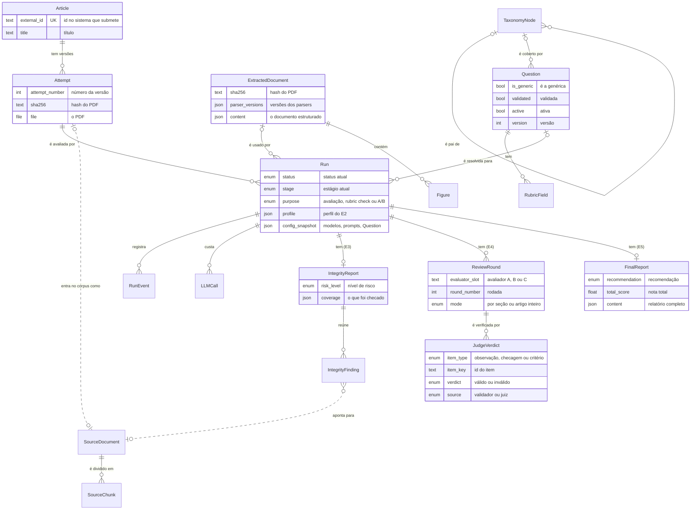
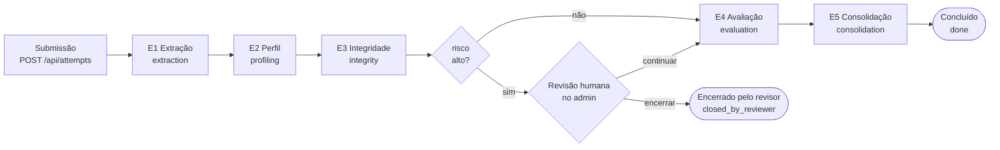
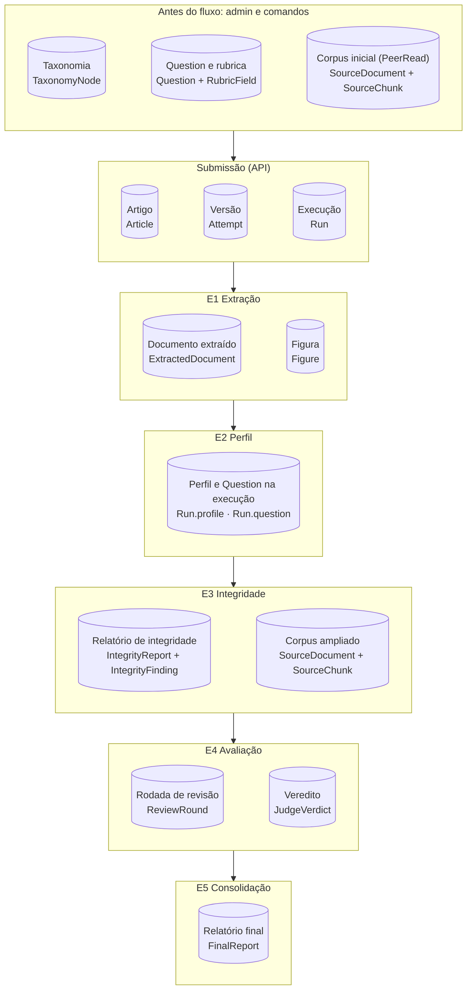
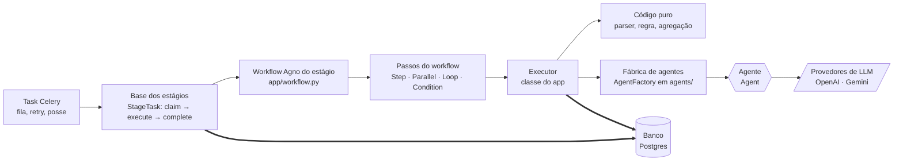
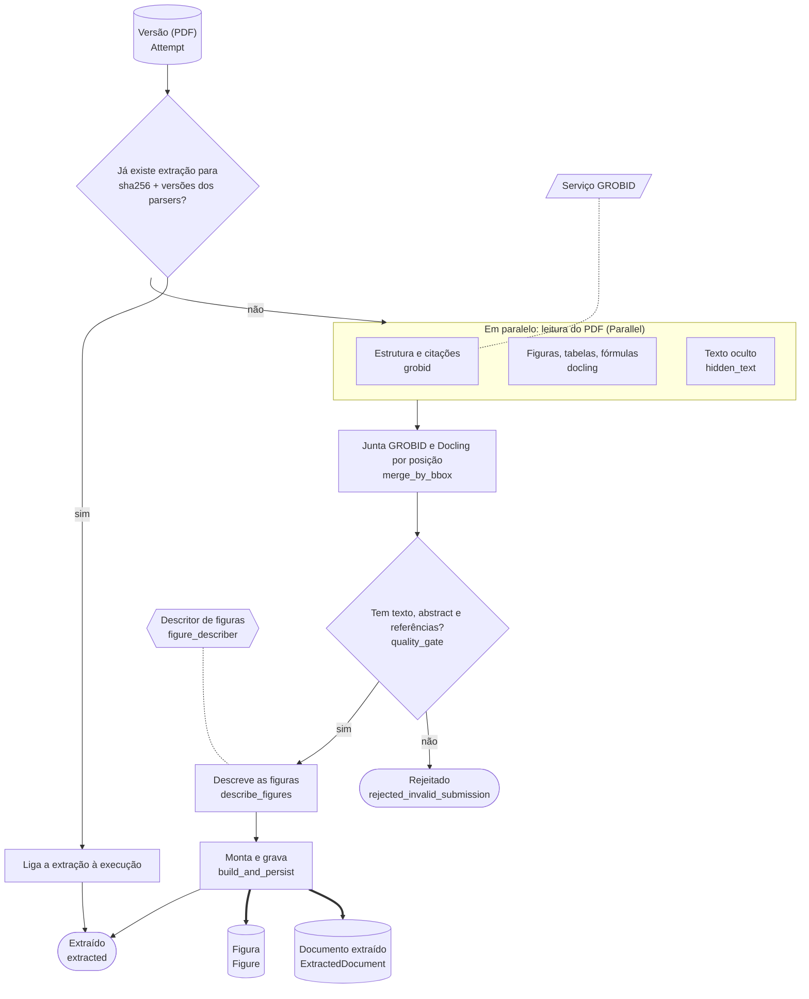
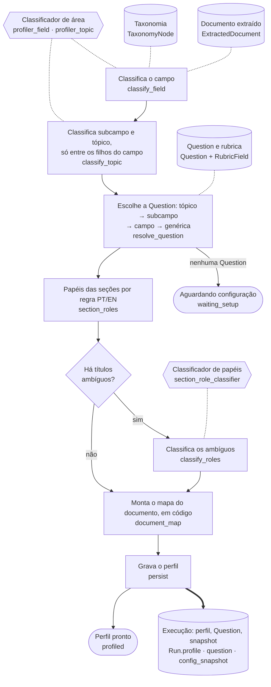
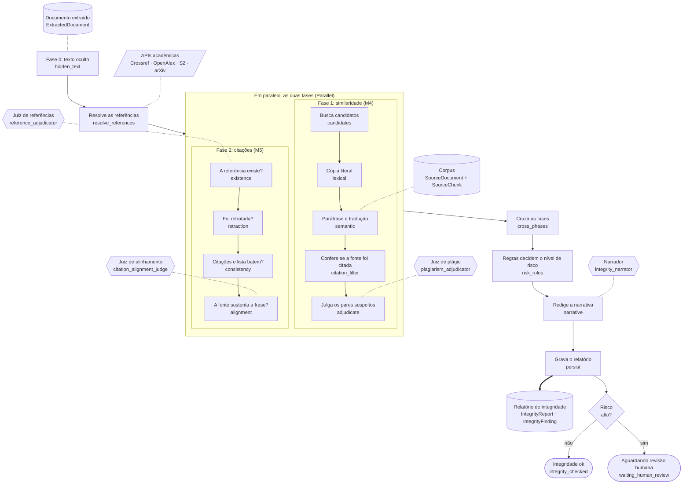
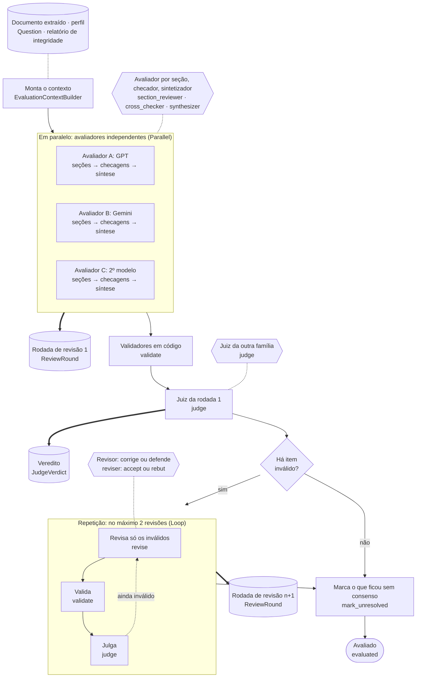
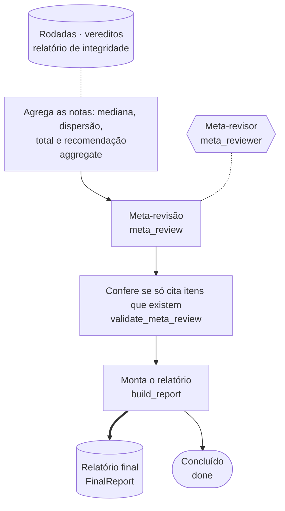

# Grafo do fluxo: entidades e ligações

O fluxo do Metis em grafos: quais entidades existem, como elas se ligam, qual estágio grava e lê cada uma, e o que acontece dentro de cada estágio. Os diagramas são Mermaid: o GitHub os desenha direto, e o VS Code também, com uma extensão de preview de Mermaid.

O detalhe de cada peça está nos documentos próprios: [Modelos de dados](data_models.md), [Orquestração](orchestration.md) e [Agentes e workflows](agents.md).

## Como ler os diagramas

Cada caixa mostra o nome em português na primeira linha e, embaixo, o identificador usado no código (model, passo, agente ou status), que fica em inglês.

| Forma | Significa |
|---|---|
| Cilindro | Entidade: uma tabela no Postgres |
| Retângulo | Passo: código, ou um passo de workflow |
| Hexágono | Agente (chamada de LLM pela `AgentFactory`) |
| Losango | Decisão |
| Pílula (cantos redondos) | Status do Run ao fim do passo |
| Paralelogramo | Serviço externo |
| Seta cheia (`-->`) | Sequência |
| Seta grossa (`==>`) | Grava |
| Linha pontilhada (`-.-`) | Lê ou usa |

## 1. As entidades

| Entidade (código) | Em português | App | O que é | Quem grava | Quem lê |
|---|---|---|---|---|---|
| `Article` | Artigo | `attempts` | O trabalho científico, pelo `external_id` de quem submete | API de submissão | Todos, pela `Attempt` |
| `Attempt` | Versão | `attempts` | Uma versão enviada do artigo (um PDF, com sha256) | API de submissão | E1 |
| `Run` | Execução | `attempts` | Uma execução do pipeline sobre uma versão; o status, o perfil e o snapshot da configuração | API (cria); `RunManagement` (status); E2 (perfil e Question) | Todos os estágios |
| `RunEvent` | Evento da execução | `attempts` | Trilha de auditoria: cada transição, retry, republicação e decisão humana | `RunManagement`, sempre | Admin, API de status |
| `LLMCall` | Chamada de LLM | `attempts` | Uma chamada de modelo, com tokens e custo | `UsageSink` do pipeline, em todo estágio com agente | Admin (custo), evals |
| `ExtractedDocument` | Documento extraído | `extraction` | O artigo estruturado: seções, referências, citações, figuras, tabelas, texto oculto. Compartilhado entre execuções (sha256 + versões dos parsers) | E1 | E2, E3, E4 |
| `Figure` | Figura | `extraction` | Recorte de uma figura, com a descrição | E1 | E4 |
| `TaxonomyNode` | Nó da taxonomia | `questions` | Um nó da taxonomia OpenAlex (domínio → campo → subcampo → tópico) | Comando `load_taxonomy` | E2 |
| `Question` | Question (perfil de avaliação) | `questions` | O perfil de avaliação de uma área | Curadoria no admin | E2 (resolve), E4 (snapshot) |
| `RubricField` | Campo da rubrica | `questions` | Um campo da rubrica da Question, com o `rubric_text` do domínio | Curadoria no admin | E4 |
| `IntegrityReport` | Relatório de integridade | `integrity` | Nível de risco, `coverage` e narrativa | E3 | Gate, E4 (resumo), E5 |
| `IntegrityFinding` | Achado de integridade | `integrity` | Um achado (similaridade, citação, texto oculto), com evidência | E3 | Gate, E5 |
| `SourceDocument` | Obra do corpus | `integrity` | Uma obra do corpus da similaridade (interna ou externa) | E3, `load_peerread` | E3 |
| `SourceChunk` | Trecho do corpus | `integrity` | Um trecho de uma obra, com o vetor do BGE-M3 | E3, `load_peerread` | E3 |
| `ReviewRound` | Rodada de revisão | `evaluation` | O estado da revisão de um avaliador numa rodada (observações, checagens, sínteses) | E4 | E4 (juiz, revisão), E5 |
| `JudgeVerdict` | Veredito | `evaluation` | O veredito de um validador ou do juiz sobre um item | E4 | E4 (loop), E5 |
| `FinalReport` | Relatório final | `evaluation` | O relatório final estruturado | E5 | API (`/report`), admin |

## 2. Como as entidades se ligam

**Como ler**
- **Um artigo tem várias versões** (`Attempt`), e cada versão pode ter várias execuções (`Run`): a avaliação normal, uma reavaliação com outra configuração, um rubric check ou um A/B (`Run.purpose`).
- **A execução é o centro:** tudo o que um estágio produz pendura nela, exceto o documento extraído, que é compartilhado entre execuções do mesmo PDF.
- **A Question não pertence à execução.** A execução aponta para ela e guarda um snapshot no `config_snapshot`, para continuar reproduzível quando a Question mudar de versão.
- **Linhas tracejadas** são referência por valor (DOI, URL), não chave estrangeira.

## 3. O fluxo: estágios e o que cada um grava e lê

### A sequência

Cada estágio (E1–E5) é uma task Celery que executa um Workflow Agno. Entre dois estágios, a execução fica parada num checkpoint no banco (`extracted`, `profiled`…), e é dali que ela retoma depois de uma falha.

### O que cada estágio cria

Cada faixa é um momento do fluxo, de cima para baixo, com as entidades que ele cria.

Em todo estágio, a mudança de status gera um evento (`RunEvent`) e cada chamada de modelo gera uma chamada de LLM (`LLMCall`).

### Quem lê e quem grava cada entidade

"Status" quer dizer que o estágio só muda o status da execução, pelo `RunManagement`.

| Entidade | Submissão | E1 | E2 | E3 | E4 | E5 | Admin e comandos |
|---|---|---|---|---|---|---|---|
| Artigo (`Article`) | grava | — | — | — | — | — | — |
| Versão (`Attempt`) | grava | lê | — | — | — | — | — |
| Execução (`Run`) | grava | status | lê e grava (perfil) | status | lê (perfil) | status | grava (gate, reprocessar) |
| Evento (`RunEvent`) | grava | grava | grava | grava | grava | grava | grava (decisões) |
| Chamada de LLM (`LLMCall`) | — | grava | grava | grava | grava | grava | grava (rascunho de Question) |
| Documento extraído (`ExtractedDocument`) | — | grava | lê | lê | lê | — | — |
| Figura (`Figure`) | — | grava | — | — | lê | — | — |
| Taxonomia (`TaxonomyNode`) | — | — | lê | — | — | — | grava |
| Question e rubrica (`Question`, `RubricField`) | — | — | lê | — | lê | — | grava |
| Corpus (`SourceDocument`, `SourceChunk`) | — | — | — | lê e grava | — | — | grava (semente) |
| Relatório de integridade (`IntegrityReport`, `IntegrityFinding`) | — | — | — | grava | lê (resumo) | lê | lê (gate) |
| Rodada de revisão (`ReviewRound`) | — | — | — | — | lê e grava | lê | — |
| Veredito (`JudgeVerdict`) | — | — | — | — | lê e grava | lê | — |
| Relatório final (`FinalReport`) | — | — | — | — | — | grava | lê |

- O E2 grava na própria execução: o perfil (área, tipo de artigo, papéis das seções, mapa do documento), a Question resolvida e o `config_snapshot`.
- O E3 lê o corpus e também o amplia: cada versão nova e cada fonte em acesso aberto viram uma obra do corpus.
- O admin e os comandos (`load_taxonomy`, curadoria, `load_peerread`) preparam o que os estágios leem.

## 4. Dentro de cada estágio

### Celery por fora, Agno por dentro

A base dos estágios muda o status da execução; os executors gravam as saídas. Num retry, o workflow roda de novo, e cada passo pula o que já está no banco.

### E1 — Extração

### E2 — Perfil

### E3 — Integridade

Até o M3, o E3 é um passo só (*pass-through*). A forma final, com as duas fases:

### E4 — Avaliação

- O juiz é sempre da outra família: o GPT julga o Gemini, e o Gemini julga o GPT.
- Cada volta da repetição termina no juiz, então a última revisão também é verificada. O que continuar inválido fica sem consenso (`unresolved`) e sai da nota.

### E5 — Consolidação

## 5. Estados da execução (Run)

Cada estado mostra o identificador do código e, embaixo, o nome em português.

```mermaid
stateDiagram-v2
    direction LR
    received: recebido
    extracting: extraindo
    extracted: extraído
    profiling: classificando
    profiled: perfil pronto
    checking_integrity: checando integridade
    integrity_checked: integridade ok
    waiting_human_review: aguardando revisão humana
    closed_by_reviewer: encerrado pelo revisor
    evaluating: avaliando
    evaluated: avaliado
    consolidating: consolidando
    done: concluído

    [*] --> received
    received --> extracting: E1
    extracting --> extracted
    extracted --> profiling: E2
    profiling --> profiled
    profiled --> checking_integrity: E3
    checking_integrity --> integrity_checked: risco baixo ou médio
    checking_integrity --> waiting_human_review: risco alto
    waiting_human_review --> integrity_checked: continuar
    waiting_human_review --> closed_by_reviewer: encerrar
    integrity_checked --> evaluating: E4
    evaluating --> evaluated
    evaluated --> consolidating: E5
    consolidating --> done
    done --> [*]
    closed_by_reviewer --> [*]
```

Fora do caminho principal (a tabela completa está em [Modelos de dados](data_models.md#transições-permitidas)):
- **Falhas.** Um estágio em andamento pode terminar em `rejected_invalid_submission` (rejeitado, final), `waiting_setup` (aguardando configuração), `error_llm` (erro do provedor de LLM), `error_external` (erro de serviço externo) ou `error_unexpected` (erro inesperado). "Reprocessar" leva esses quatro últimos de volta ao checkpoint do estágio que falhou.
- **Versão nova.** Qualquer status não final vai para `superseded` (substituído) quando chega uma versão nova do artigo.
- **Reconciliador.** Um estágio travado volta ao checkpoint de onde partiu.
