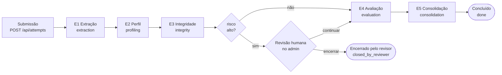

# O fluxo no Agno: ordem de construção

O desenho do fluxo (camadas, `agents/`, catálogo de agentes, workflow por estágio, estado, concorrência, custo e testes) está em [docs/agents.md](../../../docs/agents.md). Este arquivo diz **qual etapa constrói cada peça**, e em que ordem.

## O fluxo inteiro

Os diagramas estão em [docs/flow_graph.md](../../../docs/flow_graph.md):
- as entidades e como se ligam;
- o que cada estágio cria, e quem lê e grava cada entidade;
- os passos, os agentes e as entidades de cada estágio (E1–E5);
- os estados da execução.

Em resumo:

Cada estágio é uma task Celery (durável) que executa um Workflow Agno (os passos dentro do estágio).

## Peças e etapas

### Base (Trilha A, fase 1)

| Peça | Etapa | Depende de |
|---|---|---|
| Contrato `ExtractedDocument` + `render_for_llm` + fixtures do PeerRead | [1.1](05_etapas_m1_extracao.md#etapa-11--contrato-do-extracteddocument-e-fixtures-do-peerread) | — |
| Spike do Agno 3 em Python 3.14 | [1.2](05_etapas_m1_extracao.md#etapa-12--spike-do-agno-3-em-python-314) | — |
| `agents/`: `ModelSpec`, `ModelFactory` + `judge_for`, `AgentFactory`, `AgentRunner`, prompts, schemas, `ProviderLimiter`, `FakeAgentFactory`, teste de fronteira | [1.3](05_etapas_m1_extracao.md#etapa-13--pacote-agents) | 1.2 |
| `metis/concurrency.py` (`bounded_map`) | [1.3](05_etapas_m1_extracao.md#etapa-13--pacote-agents) | — |
| `LLMCall`, tabela de preços e `UsageSink` do pipeline | [1.4](05_etapas_m1_extracao.md#etapa-14--llmcall-preços-e-registro-de-uso) | 1.3, 0.4 |
| `StageTask.execute()` chamando um workflow | [0.4](04_etapas_m0_restante.md#etapa-04--pipeline-com-estágios-stub) (stub, sem Agno) e [1.9](05_etapas_m1_extracao.md#etapa-19--builder-cache-gate-e-workflow-do-e1) (primeiro workflow real) | — |

### Workflows por estágio

| Workflow | Etapas | Agentes que entram |
|---|---|---|
| E1 extração | 1.5–1.9 | `figure_describer` (1.8) |
| E2 perfil | 2.3–2.5 | `profiler_field`, `profiler_topic` (2.3), `section_role_classifier` (2.4) |
| E3 integridade | *pass-through* até o M3; fase 1 em 4.8; fase 2 e `Parallel` em 5.5 | `plagiarism_adjudicator` (4.7), `integrity_narrator` (4.8), `reference_adjudicator` (5.1), `citation_alignment_judge` (5.4) |
| E4 avaliação | 3.3–3.10 | `section_reviewer` (3.3), `cross_checker` (3.4), `synthesizer` (3.5), `whole_document_reviewer` (3.6), `judge` (3.8), `reviser` (3.9) |
| E5 consolidação | 3.11 | `meta_reviewer` |
| Curadoria | 2.6 | `question_drafter` |
| Rubric check e A/B | 3.12, 3.13 | Os do E4 e do E5, em Runs com `purpose` próprio |

## Regras que toda etapa com Agno segue

Resumo de [docs/agents.md](../../../docs/agents.md); a etapa só fica pronta se cumprir todas:

1. O agente vem da `AgentFactory`; o teste usa a `FakeAgentFactory`.
2. O passo é um executor (classe chamável) no app do estágio, com `Step(max_retries=0)`.
3. O passo persiste o que produz e pula o que já existe; há um teste que roda o workflow duas vezes e confere que a segunda não chama agente.
4. Saída com `output_schema`; `content` em `str` é tratado como saída inválida.
5. N chamadas no mesmo passo passam por `bounded_map`; o teste usa `transaction=True`.
6. O prompt é um `.md` em `agents/prompts/`, com o artigo primeiro, entre delimitadores.
7. Cada chamada gera um `LLMCall` (a partir da 1.4).
